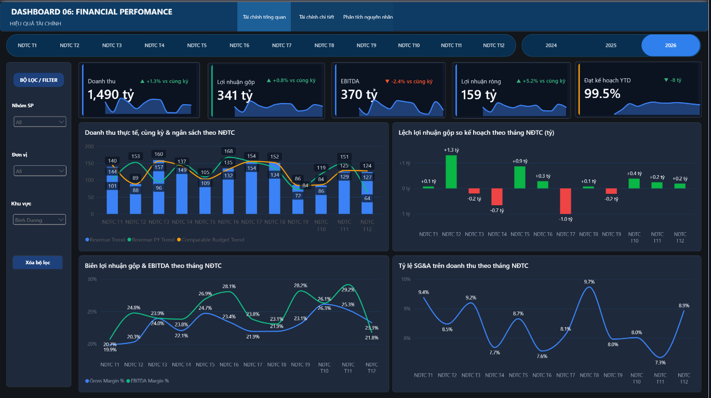

# Financial Performance Dashboard

**A Power BI portfolio project for financial performance monitoring, budget tracking, and management analysis.**

[View the Power BI file](./Financial_dashboard.pbix) · [Explore the DAX measure catalog](./docs/dax-measures.md)

## Dashboard preview

*The report interface is in Vietnamese. The figures shown are illustrative sample data and have not been reconciled.*

## Business purpose

This dashboard brings core financial results and budget comparisons into one interactive view. It is designed to help finance and business teams move from a headline KPI to the monthly trend behind it, spot changes in profitability, and identify periods that may need further investigation.

The report is organized around three views:

- **Financial overview** - headline performance and monthly trends.
- **Financial detail** - a more detailed view of financial results.
- **Root-cause analysis** - an analysis view for investigating performance drivers.

## Questions the dashboard helps answer

- How are revenue, gross profit, EBITDA, and net profit performing?
- How does actual revenue compare with the prior year and comparable budget?
- Which fiscal periods show the largest positive or negative gross-profit budget variance?
- How are gross margin, EBITDA margin, and SG&A as a share of revenue changing over time?
- How do results change when viewed by fiscal period, product group, business unit, or region?

## Key features

- KPI cards for revenue, gross profit, EBITDA, net profit, and YTD budget achievement.
- Monthly actual, prior-year, and comparable-budget trend analysis.
- Gross-profit budget variance displayed with positive and negative periods distinguished.
- Profitability and cost-ratio trends, including gross margin, EBITDA margin, and SG&A ratio.
- Fiscal-year and fiscal-period navigation, with additional product, business-unit, and region filters.
- A documented semantic-model measure catalog covering finance, budget, debt, sales, capital, and time measures.

## Metrics and business logic

- Financial statement measures in the catalog are converted from VND to **VND billions** where specified.
- Growth rates compare the current result with the corresponding prior-year period.
- Budget achievement is actual divided by the comparable budget; budget variance is actual minus budget.
- YTD measures use a September 30 fiscal year-end and are guarded when a single fiscal year is not selected.
- Budget measures are guarded when the current context contains more than one budget version.
- Ratios use `DIVIDE` to handle zero or missing denominators safely.
- Capital measures that are not supported by the required snapshot relationships are intentionally returned as blank rather than presented as misleading results.

The full DAX definitions and measure-level guardrails are available in [`docs/dax-measures.md`](./docs/dax-measures.md).

## Tools

- Microsoft Power BI Desktop (`.pbix`)
- DAX for measures, time intelligence, budget comparisons, and conditional formatting

## Project files

| File | Description |
|---|---|
| [`Financial_dashboard.pbix`](./Financial_dashboard.pbix) | Power BI report and semantic model |
| [`docs/dax-measures.md`](./docs/dax-measures.md) | DAX measure catalog and documented business guardrails |
| [`assets/financial-performance-dashboard.png`](./assets/financial-performance-dashboard.png) | Dashboard preview |

## Open the report

1. Download or clone this repository.
2. Open `Financial_dashboard.pbix` in Power BI Desktop.
3. Use the fiscal-period selector and report filters to explore the report.

## Data note

This is a portfolio demonstration. The report identifies its figures as sample data that has not been reconciled. Treat displayed values as illustrative only; they are not audited financial results and should not be used for business decisions.
